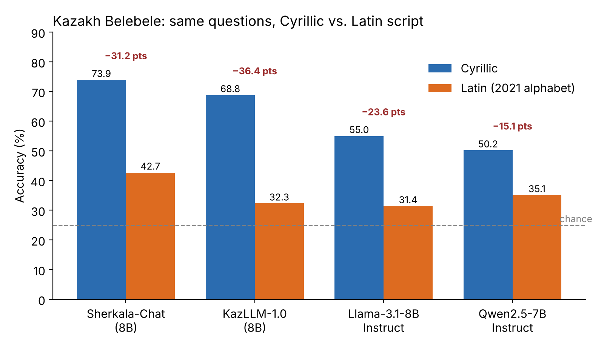
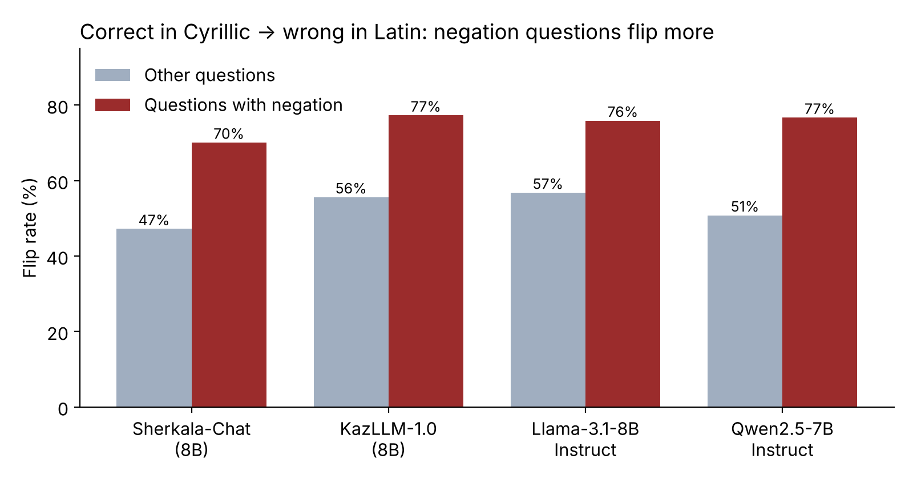
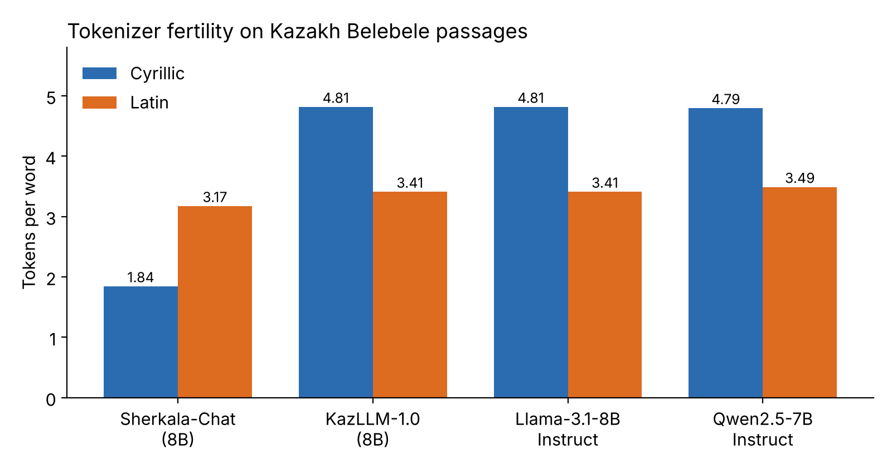

# How Well Do LLMs Handle Kazakh in Latin Script?

**A script-parallel evaluation of Kazakh LLMs on Cyrillic vs. Latin-script input**

[](https://colab.research.google.com/github/zhagypartolkyn/kazakh-latin-robustness/blob/main/notebook/kazakh_latin_robustness.ipynb)


Kazakhstan is moving the Kazakh language from Cyrillic to Latin script, but language models for Kazakh were trained almost entirely on Cyrillic text. This project measures how much these models lose when the **same** reading comprehension questions are written in the Latin alphabet, and looks at why.

Tolkyn Zhagypar · 2026

📄 **Technical report:** [`paper/paper.pdf`](paper/paper.pdf)

---

## Key findings



- **All four models lose 15–36 accuracy points** on Latin-script input (McNemar p ≤ 2×10⁻¹²). Of the answers that were correct in Cyrillic, 52–60% become wrong in Latin script.
- **The advantage of Kazakh-specific models is mostly lost.** KazLLM-1.0 is 13.8 points ahead of its base model (Llama-3.1-8B) in Cyrillic, but only 0.9 points ahead in Latin script, where it falls below the general-purpose Qwen2.5.
- **Tokenization does not explain the drop.** Three of the four models need *fewer* tokens for Latin-script Kazakh than for Cyrillic, and still lose as much or more.
- **Negation is a specific weak point.** Questions with negation (e.g. "which of the following is NOT…") flip from correct to wrong 19–26 points more often than other questions, in every model (p ≤ 0.001).



## Why this matters

The Latin alphabet for Kazakh has not yet been officially approved, but the state language policy for 2023–2029 sets targets for the share of written communication in Latin-script Kazakh: 5% by 2027, 10% by 2028 and 15% by 2029, to be implemented once the alphabet is approved ([Vlast.kz, June 2026](https://vlast.kz/novosti/69850-kazahskij-alfavit-na-osnove-latinskoj-grafiki-ese-razrabatyvaetsa-minnauki.html)). New language models are released all the time, and tools used by Kazakh speakers should be able to handle both scripts by the time Latin-script Kazakh comes into wider use.

## What we did

1. **Transliterator.** A rule-based Cyrillic → Latin mapping following the 2021 version of the alphabet ([`translit/cyr2lat.py`](translit/cyr2lat.py)). Russian-origin letters with no official equivalent follow documented conventions (ц→ts, ч→ç, щ→şş, ё→io, э→e, ю→iu, я→ia, ъ/ь removed). On 50 hand-checked sentences, it made no errors.
2. **Script-parallel benchmark.** All 900 questions of the Kazakh [Belebele](https://github.com/facebookresearch/belebele) reading comprehension benchmark, transliterated (passage, question and all four options). The two versions differ only in script, and all answer keys are preserved.
3. **Evaluation.** Four models, zero-shot, scored by the probability of the answer letter (A–D), loaded in 4-bit on a single free T4 GPU.
4. **Analysis.** Paired significance tests, tokenizer fertility, flip rates by question feature (negation, Russian-origin letters, acronyms, digits, the и/й merger) and a manual error analysis.

| Cyrillic | Latin (2021) |
|---|---|
| Қазақстан | Qazaqstan |
| Үзіндіге сәйкес | Üzındıge säikes |
| сипаттамайды ("does not describe") | sipattamaidy |
| Француз Революциясынан | Frantsuz Revoliutsiiasynan |

## Results

| Model | Cyrillic | Latin | Drop [95% CI] | Correct→wrong | Wrong→correct | Fertility Cyr → Lat |
|---|---|---|---|---|---|---|
| Sherkala-Chat (8B) | **73.9** | **42.7** | 31.2 [27.2, 35.2] | 347 | 66 | 1.84 → 3.17 |
| KazLLM-1.0 (8B) | 68.8 | 32.3 | 36.4 [32.8, 40.1] | 370 | 42 | 4.81 → 3.41 |
| Llama-3.1-8B-Instruct | 55.0 | 31.4 | 23.6 [19.7, 27.4] | 297 | 85 | 4.81 → 3.41 |
| Qwen2.5-7B-Instruct | 50.2 | 35.1 | 15.1 [11.1, 19.1] | 252 | 116 | 4.79 → 3.49 |

Accuracy in %, 900 questions per script. Fertility = tokens per word.

**Change in flip rate by question feature** (percentage points, Fisher's exact p in brackets):

| Feature | Sherkala-Chat | KazLLM-1.0 | Qwen2.5 | Llama-3.1 |
|---|---|---|---|---|
| Negation | +22.9 (<0.001) | +21.7 (<0.001) | +25.9 (<0.001) | +19.1 (0.001) |
| Russian-origin letters | −0.6 (0.93) | +1.9 (0.66) | −0.5 (0.92) | +2.8 (0.56) |
| Latin acronyms | −10.7 (0.08) | −10.5 (0.09) | −9.3 (0.15) | −11.4 (0.10) |
| Digits | −5.2 (0.42) | −3.8 (0.54) | −3.2 (0.69) | −11.5 (0.10) |

Notes:
- Negation questions are harder in Cyrillic for three of the models, so part of their effect may come from lower confidence. Sherkala-Chat answers them almost as well as other questions in Cyrillic (71.6% vs. 74.5%) and still shows a 23-point gap in Latin script.
- In the 2021 alphabet, И and Й are both written İ/i. Й appears in 10.4% of word tokens, but the merger produces only 8 ambiguous word forms in the benchmark (all spelling variants of the same words), and no answer options become identical. After excluding negation questions (whose verb endings contain й), items with й do not flip more often for three of the four models; for Llama-3.1 the difference (p = 0.019) is not significant after correction for multiple comparisons.



## Repository structure

```
kazakh-latin-robustness/
├── notebook/kazakh_latin_robustness.ipynb   # full pipeline (Colab), with outputs
├── translit/cyr2lat.py                      # transliterator + built-in tests
├── data/
│   ├── belebele_kaz_cyrl.jsonl              # 900 questions, original Cyrillic
│   ├── belebele_kaz_latn.jsonl              # the same 900 questions, 2021 Latin
│   └── translit_gold_50.csv                 # 50 hand-checked sentences
├── results/
│   ├── main_table.csv                       # accuracy, drop, McNemar, fertility
│   ├── feature_flip_rates.csv               # flip rates by question feature
│   ├── fertility.csv                        # tokens per word, both scripts
│   ├── negation_difficulty_check.csv        # Cyrillic accuracy, negation vs. other
│   ├── iy_merger_flip_rates.csv             # и/й merger vs. flips
│   ├── preds_<model>_<script>.csv           # per-question predictions (4 models × 2 scripts)
│   ├── errors_<model>.csv                   # questions correct in Cyrillic, wrong in Latin
│   ├── errors_sherkala_labeled.csv          # Sherkala errors, 50 labeled by category
│   └── figures/                             # accuracy, fertility, negation plots
└── paper/paper.pdf                          # technical report
```

`<model>` is one of `sherkala`, `kazllm`, `qwen`, `llama`; `<script>` is `cyrl` or `latn`.

## Reproduce

Open the notebook in Colab (badge above) and use **Runtime → Run all**. The notebook saves everything to Google Drive and skips finished steps, so a disconnected session can be resumed. A second run from scratch (benchmark rebuilt, model re-evaluated) reproduced the Sherkala-Chat results exactly: 73.9% / 42.7% accuracy, 347 / 66 flipped questions, and the same tokenizer fertility. Evaluating one model takes one T4 session; set `MODEL` in section 1 to `sherkala`, `kazllm`, `qwen` or `llama`. The Llama-based models require approved access on Hugging Face and an `HF_TOKEN` secret in Colab.

To use only the transliterator:

```python
from translit.cyr2lat import cyr2lat
cyr2lat("Қазақстан Республикасы")   # 'Qazaqstan Respublikasy'
```

Run its tests with `python translit/cyr2lat.py`.

## Limitations

- The Latin-script data is transliterated, not written natively in Latin script.
- One benchmark (reading comprehension on translated passages); knowledge or generation tasks may behave differently.
- 7–8B models only, zero-shot, 4-bit quantization (both scripts use the same quantized model).
- The official alphabet is still under development; the letters и, й, ы and і in particular are still being studied, and a different final choice would change part of the benchmark.
- The error analysis covers 50 errors for one model, labeled by a single annotator with LLM assistance.

## Citation

```bibtex
@misc{zhagypar2026kazakhlatin,
  title  = {How Well Do LLMs Handle Kazakh in Latin Script? A Script-Parallel Evaluation},
  author = {Zhagypar, Tolkyn},
  year   = {2026},
  howpublished = {\url{https://github.com/zhagypartolkyn/kazakh-latin-robustness}}
}
```

## License

Code: MIT. Data derived from Belebele: CC BY-SA 4.0, the same license as the original dataset.
